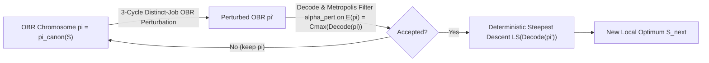

# Metropolis–Hastings vs. Simulated Annealing & Hybrid ILS+MH (`D04`)

**Decision IDs:** `D04-A` (`REJECTED` — prunes `B25`–`B28`, reducing total 67 $\to$ 63), `D04-B` (`ACCEPTED` — retains `B29`–`B32` as Metropolis-filtered ILS perturbation followed by deterministic local search)
**Scope:** Mathematical analysis of stationary Boltzmann target distributions, forward/reverse neighborhood proposal probabilities, detailed balance, SA cooling, and ILS+MH transition kernels.

---

## 1. Exact Mathematical Formulation of Standalone Metropolis–Hastings

Let $\Omega = \mathcal{S}_{\text{A}}$ be the finite state space of all feasible active schedules $\sigma$ (represented uniquely by canonical acyclic machine operation sequences $\sigma = (\sigma_0, \dots, \sigma_{m-1})$ under Serial SGS decoding; Section 4 separately discusses the OBR chromosome space $\Pi^n_m$).

- **Target Boltzmann Distribution** (Metropolis et al., 1953, DOI `10.1063/1.1699114`; Hastings, 1970, DOI `10.1093/biomet/57.1.97`):
  $$\pi(\sigma) = \frac{\exp(-\beta\, C_{\max}(\sigma))}{Z(\beta)}, \qquad Z(\beta) = \sum_{\sigma \in \Omega} \exp(-\beta\, C_{\max}(\sigma)), \quad \beta > 0$$
  where $\beta$ is a **fixed** inverse temperature (unlike SA's time-varying cooling schedule $T_t \to 0$).
- **Complete State-Level Proposal Kernel:** For neighborhood $k \in \{5, 6, 7, 8\}$, let $M_k(\sigma)$ be the set of valid syntactic moves generated from $\sigma$, and let $T(\sigma, m) \in \Omega$ denote the active schedule resulting from applying move $m$ and decoding via the `D01-B` adapter. Accounting for multiple moves (e.g., on parallel critical paths/blocks or via identical active left-shifts) that produce the same successor state $\sigma'$, the exact state-level proposal probability under uniform move selection is:
  $$q_k(\sigma' \mid \sigma) = \frac{\big|\{m \in M_k(\sigma) : T(\sigma, m) = \sigma'\}\big|}{|M_k(\sigma)|}$$
  When candidate moves are deduplicated into distinct successor states $\mathcal{N}_k(\sigma) = \{T(\sigma, m) : m \in M_k(\sigma)\} \setminus \{\sigma\}$ prior to uniform sampling, this simplifies to $q_k(\sigma' \mid \sigma) = 1 / |\mathcal{N}_k(\sigma)|$ for $\sigma' \in \mathcal{N}_k(\sigma)$ and $0$ otherwise.
- **Exact Hastings Acceptance Probability:**
  $$\alpha_{\text{MH}}(\sigma, \sigma') = \begin{cases}
  \min\!\left(1,\; \dfrac{\pi(\sigma')\, q_k(\sigma \mid \sigma')}{\pi(\sigma)\, q_k(\sigma' \mid \sigma)}\right) = \min\!\left(1,\; \exp\!\big(-\beta [C_{\max}(\sigma') - C_{\max}(\sigma)]\big)\cdot \dfrac{q_k(\sigma \mid \sigma')}{q_k(\sigma' \mid \sigma)}\right), & \text{if } q_k(\sigma \mid \sigma') > 0, \\[1.1em]
  0, & \text{if } q_k(\sigma \mid \sigma') = 0.
  \end{cases}$$
  On rejection ($\sigma'$ rejected with probability $1 - \alpha_{\text{MH}}$), the chain executes a **self-transition** $\sigma_{t+1} = \sigma_t$, introducing positive diagonal self-loop probabilities.

---

## 2. Proposal Support, Ergodicity & SA Redundancy on `N5`–`N8` (`D04-A`: `REJECTED`)

Applying exact Metropolis–Hastings to critical-block neighborhoods (`N5`–`N8`) requires carefully distinguishing five distinct Markov-chain concepts:

1. **Zero Reverse Proposal Probability for an Individual Transition:** A transition $\sigma \to \sigma'$ has $q_k(\sigma' \mid \sigma) > 0$ and $q_k(\sigma \mid \sigma') = 0$ whenever $\sigma' \in \mathcal{N}_k(\sigma)$ but $\sigma \notin \mathcal{N}_k(\sigma')$. This arises structurally in two ways on critical-block neighborhoods:
   - *Critical-Path Shift:* If $\sigma \to \sigma'$ lowers the original critical path strictly below a disjoint alternative critical path in $\sigma'$, the reversed machine arc is no longer on any critical block in $\sigma'$, so $q_k(\sigma \mid \sigma') = 0$.
   - *Non-Adjacent Block-Endpoint Insertions (`N6`, `N7`, `N8`):* Moving an inner operation $v$ before block head $b_1$ makes $v$ a block endpoint in $\sigma'$, whereas returning to $\sigma$ requires re-inserting $v$ into the interior of the block—a move pattern not generated by `N6` (which inserts only at block endpoints).
2. **Rejection of That Transition Under Hastings Acceptance:** By definition of $\alpha_{\text{MH}}(\sigma, \sigma')$, any single move with $q_k(\sigma \mid \sigma') = 0$ receives $\alpha_{\text{MH}}(\sigma, \sigma') = 0$ and is deterministically rejected by the exact Hastings rule.
3. **Mutually Supported Proposal Graph ($G_k^{\leftrightarrow}$):** Define the undirected graph of mutually reversible transitions:
   $$G_k^{\leftrightarrow} = (\Omega, E_k^{\leftrightarrow}), \qquad \{\sigma, \sigma'\} \in E_k^{\leftrightarrow} \iff q_k(\sigma' \mid \sigma) > 0 \;\land\; q_k(\sigma \mid \sigma') > 0$$
4. **Global Irreducibility vs. Local Asymmetry:** The resulting MH Markov chain is globally **irreducible** on $\Omega$ *if and only if* $G_k^{\leftrightarrow}$ is connected across all pairs $(\sigma_a, \sigma_b) \in \Omega \times \Omega$. Crucially, **a zero reverse proposal probability $q_k(\sigma \mid \sigma') = 0$ for an individual move removes only that single edge from $E_k^{\leftrightarrow}$ and does not, by itself, prove that $G_k^{\leftrightarrow}$ is globally disconnected**.
5. **Ergodicity:** On finite $\Omega$, **ergodicity** (convergence to unique stationary distribution $\pi$) holds whenever $G_k^{\leftrightarrow}$ is globally connected (irreducibility) and at least one state has non-zero self-transition probability (aperiodicity).

### Verified vs. Unverified Structural Claims
- **Established (`D04-A`):**
  - Individual transitions with $q_k(\sigma \mid \sigma') = 0$ exist in `N5`–`N8` and must be rejected ($\alpha_{\text{MH}} = 0$) under exact Hastings acceptance;
  - Evaluating $q_k(\sigma \mid \sigma')$ requires enumerating the full neighborhood of every candidate $\sigma'$ even when rejected (at least doubling graph work per proposal);
  - Conversely, omitting the Hastings correction $q_k(\sigma \mid \sigma') / q_k(\sigma' \mid \sigma)$ and using $\min(1, \exp(-\beta \Delta C_{\max}))$ makes standalone MH identical to fixed-temperature **Metropolis / Simulated Annealing** (redundant with `B21`–`B24`).
- **Downgraded to Unverified Structural Hypotheses (Not Asserted as Proven Theorems):**
  - Whether $G_k^{\leftrightarrow}$ is globally connected or disconnected across general JSSP instances for `N5`–`N8` remains an **unverified structural hypothesis** (establishing this rigorously requires exhaustive state-space graph verification on test instances or a formal graph-connectivity proof over $E_k^{\leftrightarrow}$).
  - Whether the mutually reversible edge set $E_k^{\leftrightarrow}$ of `N6`–`N8` reduces *exactly* to `N5` or to some distinct reversible subset of `N6`–`N8` also remains an **unverified hypothesis** (for instance, certain non-adjacent `N7`/`N8` reversals between two critical endpoints can remain mutually reachable when critical blocks coincide).

**Retained Practical Decision (`D04-A`, `REJECTED` — prunes `B25`–`B28`):** Because an un-corrected fixed-temperature Metropolis sampler duplicates constant-$T$ Simulated Annealing (`B21`–`B24`), while an exact Hastings-corrected sampler incurs full reverse-neighborhood enumeration overhead and rejects critical-path-shifting improving moves with $q_k(\sigma \mid \sigma') = 0$, standalone MH (`B25`–`B28`) is **pruned**. Phase B comprises **28 active configurations**, reducing the project total from **67 to 63 configurations** per `AGENTS.md` §2.2.

---

## 3. Simulated Annealing (`B21`–`B24`: `ACCEPTED`)

- **Primary Sources:** S. Kirkpatrick, C. D. Gelatt, and M. P. Vecchi (1983, DOI `10.1126/science.220.4598.671`); P. J. M. van Laarhoven, E. H. L. Aarts, and J. K. Lenstra (1992, DOI `10.1287/opre.40.1.113`).
- **Mechanism:** Uses symmetric/heuristic neighborhood sampling from $\mathcal{N}_k(\sigma)$ with Metropolis acceptance:
  $$P_{\text{accept}}(\sigma \to \sigma' \mid T_t) = \begin{cases}
  1, & \text{if } C_{\max}(\sigma') \le C_{\max}(\sigma), \\
  \exp\!\left(-\dfrac{C_{\max}(\sigma') - C_{\max}(\sigma)}{T_t}\right), & \text{otherwise.}
  \end{cases}$$
- **Frozen Schedule Specification (`D05`):**
  - Initial temperature $T_0$ calibrated from initial neighborhood sample (target initial acceptance $\approx 0.80$: $T_0 = -\overline{\Delta C^+}/\ln(0.80)$, minimum floor $T_0 \ge 1.0$).
  - Geometric cooling $T_{t+1} = \max(T_{\min}, \gamma T_t)$ with $\gamma = 0.95$, $T_{\min} = 10^{-3}$, epoch length $E_{\text{SA}} = 2L$ proposals per temperature step.
  - Stopping criterion: total objective evaluation budget exhausted ($100L$ screening, $500L$ confirmatory). Track best-so-far $\sigma_{\text{best}}$ independently of current chain state $\sigma_t$.

---

## 4. Metropolis-Filtered ILS Perturbation + Deterministic Local Search (`B29`–`B32`: `ACCEPTED`)

- **State Definition & Energy (`D04-B`):** In `B29`–`B32`, the Metropolis filter operates on the **OBR chromosome state space $\Pi^n_m$** starting from canonical OBR $\pi = \pi_{\text{canon}}(S) \in \Pi^n_m$ (`D01-B`), with objective energy:
  $$E(\pi) = C_{\max}\!\big(\mathrm{Decode}(\pi)\big)$$
  where $\mathrm{Decode}(\cdot)$ is the canonical Serial SGS active decoder (`D01-A`).

- **Exact Move Definition Comparison (Distinguishing Options A, B, and C):**
  - **Option A — Pairwise 2-Swap:** Select two positions $\{i_1 < i_2\}$ with distinct job IDs ($\pi[i_1] \neq \pi[i_2]$) and transpose them. Proposal degree:
    $$D_{2\text{swap}} = \sum_{0 \le a < b < n} m_a m_b = \frac{1}{2}\left(L^2 - \sum_{j=0}^{n-1} m_j^2\right)$$
    Every move produces a successor at Hamming distance $d_H(\pi, \pi') = 2$. *(Retained solely as an automatic fallback if a synthetic fixture has $n = 2$ jobs, where 3 distinct-job positions do not exist; all Tracks 1–5 benchmarks satisfy $n \ge 3$.)*
  - **Option B — Three-Position Cyclic Permutation / 3-Cycle *(Selected Canonical Kernel)*:** Select an unordered triple of positions $\{i_1 < i_2 < i_3\} \subset \{0, \dots, L-1\}$ carrying **pairwise distinct job IDs** ($\pi[i_1], \pi[i_2], \pi[i_3]$ all distinct, requiring $n \ge 3$) and apply one of the two fixed-point-free cyclic permutations uniformly at random (`perturbation` stream):
    - Forward 3-cycle $\sigma_+ = (i_1 \; i_2 \; i_3)$: $(\pi'[i_1], \pi'[i_2], \pi'[i_3]) = (\pi[i_3], \pi[i_1], \pi[i_2])$.
    - Inverse 3-cycle $\sigma_- = (i_1 \; i_3 \; i_2) = \sigma_+^{-1}$: $(\pi'[i_1], \pi'[i_2], \pi'[i_3]) = (\pi[i_2], \pi[i_3], \pi[i_1])$.
    The number of unordered position triples with pairwise distinct job IDs is:
    $$T = \sum_{0 \le a < b < c < n} m_a m_b m_c$$
    Because both cyclic orientations $\sigma_+$ and $\sigma_-$ are allowed, the exact proposal degree is:
    $$D_{3\text{cycle}} = 2\,T = 2 \sum_{0 \le a < b < c < n} m_a m_b m_c = \frac{1}{3}\left(L^3 - 3 L \sum_{j=0}^{n-1} m_j^2 + 2 \sum_{j=0}^{n-1} m_j^3\right)$$
  - **Option C — Sequential Composition of Three Pairwise 2-Swaps ($P^3$):** Applying three independent Option A swaps sequentially produces variable Hamming distances $d_H \in \{0, 2, 3, 4, 5, 6\}$ with unequal multi-path transition counts and non-zero self-return probability ($\pi' = \pi$). Rejected in favor of Option B's clean single-step 3-cycle kernel.

- **Exact OBR Proposal Distribution, Injectivity & Symmetry Proof:**
  1. *Constant Degree:* For fixed instance job multiplicities $(m_0, \dots, m_{n-1})$, every valid chromosome $\pi \in \Pi^n_m$ has identical degree $D_{3\text{cycle}}$.
  2. *One-to-One Successor Mapping (Zero Duplicate Successor Chromosomes):* For any valid move $(\{i_1 < i_2 < i_3\}, \sigma \in \{\sigma_+, \sigma_-\})$ from $\pi$, because $\pi[i_1], \pi[i_2], \pi[i_3]$ are pairwise distinct and $\sigma_\pm$ has no fixed points, every entry at $\{i_1, i_2, i_3\}$ strictly changes, so the changed-locus set $\{i : \pi'[i] \neq \pi[i]\} = \{i_1, i_2, i_3\}$ ($d_H(\pi, \pi') = 3$) uniquely determines the position triple, and $\pi'_+[i_1] = \pi[i_3] \neq \pi[i_2] = \pi'_-[i_1]$ uniquely determines the orientation. Therefore, all $D_{3\text{cycle}}$ syntactic moves yield **pairwise distinct successor chromosomes** $\pi' \neq \pi$ (no duplicate successor chromosomes and no self-transitions).
  3. *Inverse-Move Closure:* If $\pi'$ arises from $\pi$ via $(\{i_1 < i_2 < i_3\}, \sigma)$, then $\pi'[i_1], \pi'[i_2], \pi'[i_3]$ remain pairwise distinct, so the unique inverse $(\{i_1 < i_2 < i_3\}, \sigma^{-1})$ belongs to the valid 3-cycle move set of $\pi'$ and maps $\pi' \mapsto \pi$.
  4. *Exact Symmetric OBR Proposal Probability:*
     $$q_{\text{OBR}}(\pi' \mid \pi) = \begin{cases}
     \dfrac{1}{D_{3\text{cycle}}}, & \text{if } \pi' \text{ differs from } \pi \text{ by one valid 3-cycle}, \\[0.8em]
     0, & \text{otherwise.}
     \end{cases}$$
     Hence $q_{\text{OBR}}(\pi' \mid \pi) = q_{\text{OBR}}(\pi \mid \pi') = 1 / D_{3\text{cycle}}$ for every connected pair $(\pi, \pi') \in \Pi^n_m \times \Pi^n_m$.

- **Exhaustive Small-Instance Verification (Option A vs. Option B):**

  | Fixture | Job Multiplicities $(m_j)$ | $L$ | $D_{2\text{swap}}$ (Option A) | $T = \sum_{a<b<c} m_a m_b m_c$ | $D_{3\text{cycle}} = 2T$ (Option B) | Unique Successors Enumerated | $q_{\text{fwd}} = q_{\text{rev}}$ |
  |---|---|---:|---:|---:|---:|---:|---:|
  | Tiny $3 \times 1$ | `(1, 1, 1)` | 3 | 3 | 1 | **2** | 2 (all $d_H=3$) | $1/2$ |
  | Asymmetric `(2,1,2)` | `(2, 1, 2)` | 5 | 8 | 4 | **8** | 8 (all $d_H=3$) | $1/8$ |
  | Rectangular $3 \times 2$ | `(2, 2, 2)` | 6 | 12 | 8 | **16** | 16 (all $d_H=3$) | $1/16$ |
  | Rectangular $4 \times 2$ | `(2, 2, 2, 2)` | 8 | 24 | 32 | **64** | 64 (all $d_H=3$) | $1/64$ |
  | Rectangular $3 \times 3$ (Xie Table 1) | `(3, 3, 3)` | 9 | 27 | 27 | **54** | 54 (all $d_H=3$) | $1/54$ |

- **OBR State Space vs. Decoded Schedule Quotient Space:**
  OBR proposal symmetry $q_{\text{OBR}}(\pi' \mid \pi) = q_{\text{OBR}}(\pi \mid \pi')$ **does not transfer** to the quotient space of decoded active schedules $\Omega = \mathcal{S}_{\text{A}}$. Serial SGS decoding is many-to-one, partitioning $\Pi^n_m$ into schedule equivalence classes $[\![S]\!] = \{\pi \in \Pi^n_m : \mathrm{Decode}(\pi) = S\}$ of unequal sizes. Starting from representative $\pi_A \in [\![S_A]\!]$, the aggregate schedule transition probability is:
  $$q_{\text{sched}}(S_B \mid \pi_A) = \sum_{\pi' \in [\![S_B]\!]} q_{\text{OBR}}(\pi' \mid \pi_A)$$
  Because $|[\![S_A]\!]|$ and $|[\![S_B]\!]|$ generally differ, $q_{\text{sched}}(S_B \mid \pi_A) \neq q_{\text{sched}}(S_A \mid \pi_B)$.
  *Exhaustive $3 \times 2$ Counterexample ($J_0: [(M_0,3),(M_1,2)]$, $J_1: [(M_1,4),(M_0,1)]$, $J_2: [(M_0,2),(M_1,3)]$):* Exhaustively enumerating all $|\Pi^3_2| = 90$ chromosomes produces $|\mathcal{S}_{\text{A}}| = 10$ active schedules. Choosing representatives $\pi_A = (0,0,1,1,2,2)$ in schedule $A$ ($C_{\max} = 12$, $|[\![A]\!]| = 7$) and $\pi_B = (0,1,0,1,2,2)$ in schedule $B$ ($C_{\max} = 10$, $|[\![B]\!]| = 11$) under Option B ($D_{3\text{cycle}} = 16$) yields **$q_{\text{sched}}(B \mid \pi_A) = 4/16 = 0.2500 \neq q_{\text{sched}}(A \mid \pi_B) = 2/16 = 0.1250$**.

- **Structural OBR Validity & Schedule Acyclicity Proof:**
  - *OBR Validity:* Because a 3-cycle only permutes existing job identifiers across three positions, job multiplicity counts $m_j$ and chromosome length $L$ are preserved identically; **malformed OBR chromosomes are impossible by structural invariant** (this is a deterministic proof over $\Pi^n_m$, not an experimental measurement).
  - *Disjunctive-Graph Feasibility:* Every valid OBR chromosome $\pi' \in \Pi^n_m$ decoded by Serial SGS (`D01-A`) constructs an interval schedule respecting intra-job precedence and non-overlapping machine intervals, whose induced disjunctive graph is **guaranteed acyclic by construction** (independent of disjunctive-graph arc reversal checks used inside `N5`–`N8`).

- **Metropolis Filter & Post-Filter Local Search (`B29`–`B32`):**
  1. Decode $\pi'$ (`1` eval) to obtain $E(\pi') = C_{\max}(\mathrm{Decode}(\pi'))$.
  2. Apply the Metropolis perturbation filter (`mh_filter` stream, $\beta_{\text{filter}} = 2.0 / \overline{p}$):
     $$\alpha_{\text{pert}}(\pi, \pi') = \min\!\Big(1,\; \exp\!\big(-\beta_{\text{filter}} [E(\pi') - E(\pi)]\big)\Big)$$
  3. If accepted, run deterministic Steepest Descent $\mathrm{LS}_k(\mathrm{Decode}(\pi'))$ ($k \in \{5, 6, 7, 8\}$) to obtain $S_{\text{next}}$ and update $S \leftarrow S_{\text{next}}$; if rejected, skip descent and retain $S$. Track best-so-far $S_{\text{best}}$ independently.
  4. **Detailed-Balance Disclaimer:** `B29`–`B32` is a **Metropolis-filtered ILS perturbation followed by deterministic local search**. Neither the schedule-quotient projection nor the complete perturbation-plus-Steepest-Descent composition satisfies Metropolis–Hastings detailed balance.

---

## 5. Primary References
- N. Metropolis, A. W. Rosenbluth, M. N. Rosenbluth, A. H. Teller, and E. Teller, "Equation of State Calculations by Fast Computing Machines," *The Journal of Chemical Physics*, vol. 21, no. 6, pp. 1087–1092, 1953. DOI: `10.1063/1.1699114`
- W. K. Hastings, "Monte Carlo sampling methods using Markov chains and their applications," *Biometrika*, vol. 57, no. 1, pp. 97–109, 1970. DOI: `10.1093/biomet/57.1.97`
- S. Kirkpatrick, C. D. Gelatt, and M. P. Vecchi, "Optimization by Simulated Annealing," *Science*, vol. 220, no. 4598, pp. 671–680, 1983. DOI: `10.1126/science.220.4598.671`
- P. J. M. van Laarhoven, E. H. L. Aarts, and J. K. Lenstra, "Job Shop Scheduling by Simulated Annealing," *Operations Research*, vol. 40, no. 1, pp. 113–125, 1992. DOI: `10.1287/opre.40.1.113`
- H. R. Lourenço, O. C. Martin, and T. Stützle, "Iterated Local Search: Framework and Applications," in *Handbook of Metaheuristics*, 2nd ed., Springer, pp. 363–397, 2010. DOI: `10.1007/978-1-4419-1665-5_12`
