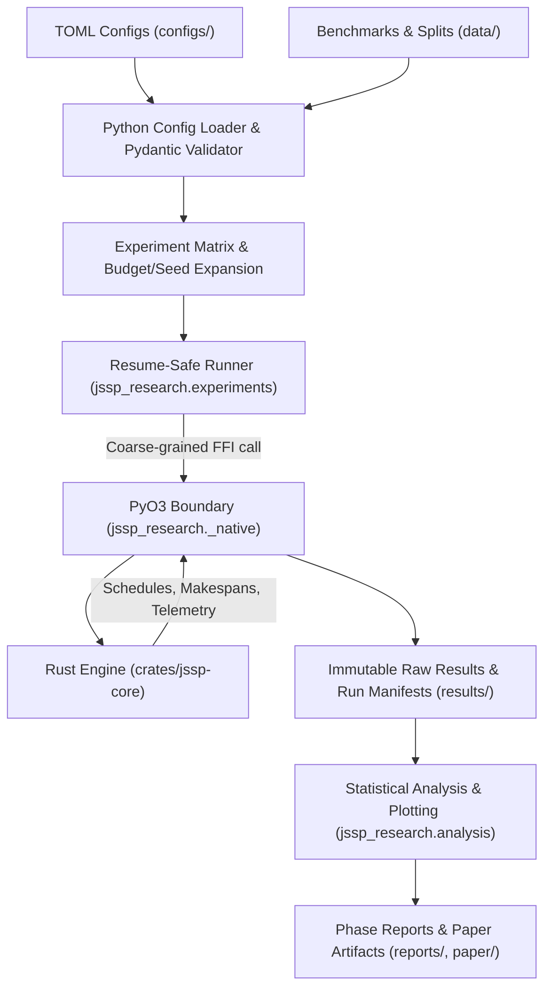

# PROJECT_STRUCTURE_V1 — Architecture & Repository Specification

**Status:** M0 Architectural Specification (Grounded in Actual Checked-In Tree)
**Project:** `jssp-research` (`jssp_research` / `crates/jssp-core` / `crates/jssp-python`)
**Primary Sources:** Checked-in directory tree, [`pyproject.toml`](file:///home/abdelhalimyasser/Downloads/jssp-research/pyproject.toml), [`AGENTS.md`](file:///home/abdelhalimyasser/Downloads/jssp-research/AGENTS.md), [`README.md`](file:///home/abdelhalimyasser/Downloads/jssp-research/README.md)

---

## 1. Repository State Overview & Classification Legend

Every file and subsystem in this specification is tagged using the following legend so that planned structure is never confused with completed code:

- **`[IMPLEMENTED / POPULATED]`** — File contains verified non-empty content/configuration/code.
- **`[PARTIALLY POPULATED]`** — Metadata or build declaration exists, but corresponding source/lockfiles are missing or out of sync.
- **`[PLACEHOLDER — 0 BYTES]`** — File exists in the checked-in workspace scaffold as an empty `0`-byte file.
- **`[PROPOSED RESEARCH MECHANISM]`** — Novel research hypothesis/component (specifically Dual-View memetic pairing and gating).
- **`[UNRESOLVED DECISION]`** — Requires explicit scientific or engineering decision before implementation/confirmatory execution.

**Repository Reality Summary:** Out of **219** tracked repository files (**218** when excluding root `.gitignore`), only **5 files** are populated (`AGENTS.md`, `README.md`, `pyproject.toml`, `.python-version`, `uv.lock`), while **214 files** (including all Rust sources, all Python sources, all TOML configs, all test files, all fixtures, and all existing `docs/` subfiles outside `docs/research/`) are **0-byte empty placeholders**.

---

## 2. Actual Checked-In Repository Tree

```text
jssp-research/
├── .gitignore                        [PLACEHOLDER — 0 BYTES]
├── .python-version                   [IMPLEMENTED / POPULATED] (5 bytes: "3.15")
├── AGENTS.md                         [IMPLEMENTED / POPULATED] (24,044 bytes; 300 lines)
├── CITATION.cff                      [PLACEHOLDER — 0 BYTES]
├── Cargo.lock                        [PLACEHOLDER — 0 BYTES]
├── Cargo.toml                        [PLACEHOLDER — 0 BYTES]
├── LICENSE                           [PLACEHOLDER — 0 BYTES]
├── NOTICE                            [PLACEHOLDER — 0 BYTES]
├── README.md                         [IMPLEMENTED / POPULATED] (38,152 bytes; 684 lines)
├── pyproject.toml                    [PARTIALLY POPULATED]     (1,281 bytes; 61 lines; out of sync with uv.lock)
├── rust-toolchain.toml               [PLACEHOLDER — 0 BYTES] (blocks cargo invocations until populated/removed)
├── rustfmt.toml                      [PLACEHOLDER — 0 BYTES]
├── uv.lock                           [PARTIALLY POPULATED]     (207,238 bytes; 830 lines; stale vs pyproject.toml)
├── benches/                          [PLACEHOLDER — 0 BYTES] (5 files)
│   ├── end_to_end/benchmark_protocol.md
│   └── rust/{decoder,ga_generation,makespan,n5_n8_generation}.rs
├── configs/                          [PLACEHOLDER — 0 BYTES] (29 TOML files)
│   ├── benchmarks/{core_classical,extensions,large_tai,stress_tai,synthetic_generalization}.toml
│   ├── defaults/{decoder,problem,representation,runtime}.toml
│   ├── matrix/{phase_a_matrix,phase_b_matrix,phase_c_matrix}.toml
│   ├── phase_a/{initializers,mwr,qmc}.toml
│   ├── phase_b/{descent,ils,ils_mh_hybrid,metropolis_hastings,neighbourhoods,simulated_annealing,tabu_search}.toml
│   ├── phase_c/{classic_ga,dual_view,memetic_ga}.toml
│   └── protocols/{confirmatory,pilot,screening,stress_test}.toml
├── crates/                           [PLACEHOLDER — 0 BYTES] (82 files)
│   ├── jssp-core/                    (76 files: Cargo.toml, 70 src/*.rs, 5 tests/*.rs)
│   └── jssp-python/                  (6 files: Cargo.toml, 5 src/*.rs)
├── data/                             (5 .gitignore files in bounds/, metadata/, processed/, raw/, splits/)
├── docs/                             (15 0-byte placeholders + 3 M0 docs in docs/research/)
│   ├── algorithms/{dual_view,mh_vs_sa,n5_n6_n7_n8_definitions,obr_decoder,qmc_mapping}.md
│   ├── architecture/{data_flow,overview,python_rust_boundary}.md
│   ├── benchmarks/{benchmark_provenance,catalog}.md
│   ├── decisions/ADR-0001-python-rust-workspace.md
│   ├── experiments/{fairness_protocol,phase_a,phase_b,phase_c}.md
│   └── research/{RESEARCH_PLAN_V1,PROJECT_STRUCTURE_V1,REPOSITORY_AUDIT_V1}.md  [IMPLEMENTED / POPULATED in M0]
├── paper/                            (5 .gitignore files in bibliography/, figures/, manuscript/, supplementary/, tables/)
├── reports/                          (5 .gitignore files in benchmark_generalization/, figures/, phase_a/, phase_b/, phase_c/)
├── results/                          (5 .gitignore files in checkpoints/, logs/, manifests/, raw/, summaries/)
├── scripts/                          [PLACEHOLDER — 0 BYTES] (6 .py files)
│   ├── build_experiment_matrix.py
│   ├── fetch_benchmarks.py
│   ├── make_paper_outputs.py
│   ├── merge_results.py
│   ├── run_phase.py
│   └── validate_benchmarks.py
├── src/jssp_research/                [PLACEHOLDER — 0 BYTES] (39 .py files)
│   ├── __init__.py, cli.py
│   ├── analysis/                     (7 files)
│   ├── benchmarks/                   (6 files)
│   ├── config/                       (4 files)
│   ├── experiments/                  (7 files)
│   ├── native/                       (2 files)
│   ├── reporting/                    (4 files)
│   ├── results/                      (4 files)
│   └── utils/                        (3 files)
└── tests/                            [PLACEHOLDER — 0 BYTES] (10 files)
    ├── fixtures/{expected_schedules.json,medium_jssp.txt,tiny_jssp.txt}
    ├── integration/test_{end_to_end_small_instance,python_rust_bridge,reproducible_run}.py
    └── python/test_{config_validation,experiment_matrix,result_schema,seed_derivation}.py
```

---

## 3. Rust Workspace Responsibilities (`crates/`)

Per `AGENTS.md` §4, **Rust is the sole authoritative source of truth** for JSSP modeling, OBR validation, schedule decoding, feasibility verification, makespan calculation, graph/neighborhood operators, initializers, local search, metaheuristics, and memetic GAs.

### 3.1 Workspace Manifests
- Root [`Cargo.toml`](file:///home/abdelhalimyasser/Downloads/jssp-research/Cargo.toml) `[PLACEHOLDER — 0 BYTES]`: Intended Cargo workspace unifying `crates/jssp-core` and `crates/jssp-python`, shared dependency pins, and workspace release/bench profiles.
- [`Cargo.lock`](file:///home/abdelhalimyasser/Downloads/jssp-research/Cargo.lock) `[PLACEHOLDER — 0 BYTES]`: Intended deterministic Cargo dependency lockfile.

### 3.2 `crates/jssp-core` (`76` files — `[PLACEHOLDER — 0 BYTES]`)
Core pure-Rust library crate (no Python/PyO3 dependencies):

| Module Path | Files | Planned Responsibility |
|---|---|---|
| `Cargo.toml`, `src/lib.rs`, `src/error.rs` | 3 | Crate manifest, public module exports, explicit typed `JsspError` hierarchy |
| `src/model/` | `mod.rs`, `identifiers.rs`, `instance.rs`, `machine_sequence.rs`, `operation.rs`, `schedule.rs` | Strongly typed IDs (`JobId`, `MachineId`, `OpId`), immutable rectangular/extension JSSP instance structs, operation routes, machine sequences, decoded `Schedule` |
| `src/representation/` | `mod.rs`, `obr.rs` | OBR chromosome type, exact job-ID bounds and multiplicity $m_j$ validation |
| `src/decoder/` | `mod.rs`, `serial_insertion.rs` | Canonical deterministic serial insertion schedule-generation decoder (`[UNRESOLVED DECISION]` `D01` for gap/tie rules) |
| `src/feasibility/` | `mod.rs`, `disjunctive_graph.rs`, `machine_exclusivity.rs`, `precedence.rs` | Independent verification of job precedence, machine non-overlap, and disjunctive graph acyclicity |
| `src/objective/` | `mod.rs`, `makespan.rs` | Authoritative $C_{\max} = \max_o C_o$ calculation and exact reference evaluator for validating incremental moves |
| `src/graph/` | `mod.rs`, `critical_path.rs`, `critical_blocks.rs` | Longest-path / critical-path extraction, head/tail times, and critical-block decomposition |
| `src/neighborhoods/` | `mod.rs`, `moves.rs`, `n5.rs`, `n6.rs`, `n7.rs`, `n8.rs`, `validation.rs` | Source-verified N5–N8 move generators (`[UNRESOLVED DECISION]` `D03`), disjunctive-graph move application, OBR stable topological re-encoding, and round-trip assertion |
| `src/initialization/` | `mod.rs`, `random.rs`, `mwr.rs`, `monte_carlo.rs`, `qmc/{mod,halton,sobol,scrambling,discrete_mapping}.rs` | Uniform random, deterministic MWR, MC+MWR ($\alpha \in \{0.5, 1, 2\}$), Halton/Sobol + scrambling, population mixing, sequential inverse-CDF mapping (`[UNRESOLVED DECISION]` `D02`) |
| `src/local_search/` | `mod.rs`, `evaluation.rs`, `descent/{mod,steepest,first_improvement,random_improvement}.rs` | Budgeted evaluation counter wrapper and Steepest / First / Random Improvement descent engines |
| `src/metaheuristics/` | `mod.rs`, `tabu_search.rs`, `ils.rs`, `simulated_annealing.rs`, `metropolis_hastings.rs`, `ils_mh.rs` | Tabu Search, ILS, SA, fixed-target MH (`[UNRESOLVED DECISION]` `D04`), and Hybrid ILS + MH pre-descent filter |
| `src/genetic/` | `mod.rs`, `population.rs`, `selection.rs`, `crossover.rs`, `mutation.rs`, `elitism.rs` | OBR-preserving GA operators (e.g., POX/JOX, swap/insert mutation, deterministic tournament/elitism) (`[UNRESOLVED DECISION]` `D07`) |
| `src/memetic/` | `mod.rs`, `lamarckian.rs`, `baldwinian.rs`, `partial_lamarckian.rs`, `dual_view/{mod,individual,fixed_gate,adaptive_gate,reproduction,migration}.rs` | LGA (`C02`), BGA (`C03`), PLGA (`C04`), and **`[PROPOSED RESEARCH MECHANISM]`** Dual-View (`C05`–`C11`, `[UNRESOLVED DECISION]` `D06`) |
| `src/rng/` | `mod.rs`, `streams.rs` | Master seed splitter generating isolated named PRNG substreams |
| `src/telemetry/` | `mod.rs`, `counters.rs`, `run_metrics.rs` | Objective-evaluation, move, feasibility, acceptance, anytime, diversity, and Dual-View gate counters |
| `tests/` | `decoder_correctness.rs`, `feasibility.rs`, `neighbourhood_round_trip.rs`, `obr_properties.rs`, `reproducibility.rs` | Rust correctness, round-trip, property, and determinism test suites *(Note spelling variance: `neighborhoods/` US vs. `neighbourhood_round_trip.rs` UK)* |

### 3.3 `crates/jssp-python` (`6` files — `[PLACEHOLDER — 0 BYTES]`)
Thin PyO3 FFI wrapper crate exposing `jssp_research._native`:

| File | Planned Responsibility |
|---|---|
| `Cargo.toml` | Crate manifest (`cdylib` via PyO3 depending on `jssp-core` and `pyo3`) |
| `src/lib.rs` | `#[pymodule]` definition named `_native` exporting Python bindings and error conversions |
| `src/instance_api.rs` | Instance parsing/validation wrappers returning instance metadata to Python |
| `src/run_api.rs` | Coarse-grained batch/single-run entrypoints for Phases A, B, and C |
| `src/result_api.rs` | Typed Python-serializable result/telemetry DTOs returned from completed runs |
| `src/validation_api.rs` | Direct OBR/schedule verification entrypoints for Python tests and fixture validation |

---

## 4. Python Package Responsibilities (`src/jssp_research/` and `scripts/`)

Per `AGENTS.md` §4, Python owns configuration validation, matrix expansion, benchmark metadata/splits, run orchestration, manifest persistence, statistical analysis, and publication exports.

### 4.1 `src/jssp_research/` (`39` files — `[PLACEHOLDER — 0 BYTES]`)
| Subpackage / File | Files | Planned Responsibility |
|---|---|---|
| `__init__.py`, `cli.py` | 2 | Package export and `jssp` CLI entrypoint declared in `[project.scripts]` of `pyproject.toml` |
| `config/` | `__init__.py`, `loader.py`, `schema.py`, `validation.py` | TOML loading, hierarchical merging, and Pydantic validation rejecting missing/invalid parameters |
| `benchmarks/` | `__init__.py`, `catalog.py`, `checksums.py`, `loaders.py`, `provenance.py`, `splits.py` | Benchmark registry across Tracks 1–5, SHA-256 verification, BKS snapshot loading, dev/held-out split management |
| `experiments/` | `__init__.py`, `budgets.py`, `manifests.py`, `matrix.py`, `registry.py`, `runner.py`, `seeds.py` | Matrix expansion (`A01`–`A24`, `B01`–`B32`, `C01`–`C11`), budget parity checks, deterministic seed derivation, resume-safe execution runner, immutable run manifests |
| `native/` | `__init__.py`, `bridge.py` | Typed Python wrapper over `jssp_research._native` translating dicts/dataclasses and surfacing clear Rust exceptions |
| `results/` | `__init__.py`, `reader.py`, `schema.py`, `writer.py` | Append-only raw result writer/reader and Pydantic result record schemas |
| `analysis/` | `__init__.py`, `ablation.py`, `diversity.py`, `metrics.py`, `plots.py`, `rpd.py`, `statistics.py` | RPD calculation, diversity/duplicate analysis, Dual-View ablation metrics, Friedman/Wilcoxon/Holm/effect-size tests, diagnostic plots |
| `reporting/` | `__init__.py`, `export.py`, `figures.py`, `tables.py` | Automated generation of LaTeX/CSV/Markdown tables and publication figures into `reports/` and `paper/` |
| `utils/` | `__init__.py`, `logging.py`, `provenance.py` | Structured logging and environment/Git/hardware provenance capture |

### 4.2 `scripts/` (`6` files — `[PLACEHOLDER — 0 BYTES]`)
- `fetch_benchmarks.py` — Controlled benchmark retrieval with URL/license/checksum logging.
- `validate_benchmarks.py` — Track integrity, dimension, and SHA-256 verification.
- `build_experiment_matrix.py` — Materializes and checks Phase A/B/C experiment matrices.
- `run_phase.py` — CLI driver for pilot, screening, confirmatory, or stress-test runs.
- `merge_results.py` — Safely aggregates immutable raw outputs into summary tables.
- `make_paper_outputs.py` — Re-generates all `reports/` and `paper/` tables and figures solely from stored raw results and manifests.

---

## 5. PyO3 & Maturin Boundary Contract

Verified from [`pyproject.toml`](file:///home/abdelhalimyasser/Downloads/jssp-research/pyproject.toml):
```toml
[build-system]
requires = ["maturin>=1.16,<2.0"]
build-backend = "maturin"

[tool.maturin]
manifest-path = "crates/jssp-python/Cargo.toml"
python-source = "src"
module-name = "jssp_research._native"
bindings = "pyo3"
```

**Architectural Boundary Rules:**
1. **Extension Module Name:** `crates/jssp-python/src/lib.rs` must define `#[pymodule] fn _native(...)` matching `module-name = "jssp_research._native"`.
2. **Coarse-Grained FFI Only:** Python submits a full run (or batch of runs) specifying instance data, resolved configuration struct, budget, and master seed. Per-move, per-neighbor, or per-generation Python callbacks from inside Rust search loops are forbidden.
3. **No Duplicate Semantics:** Python must never reimplement the OBR decoder, makespan calculation, or N5–N8 moves for production execution (lightweight independent checks in `tests/` only).
4. **Error Propagation:** Rust `JsspError` variants convert to explicit Python exceptions carrying run context so failed runs still emit diagnostic manifests.
5. **Data Structures:** `jssp-core` owns compact Rust slices/vectors (`Vec<u32>`, etc.). NumPy is strictly for Python-side analysis and plotting.

---

## 6. Configuration Architecture (`configs/`)

All 29 TOML files are currently `[PLACEHOLDER — 0 BYTES]`. The intended 5-layer hierarchy composes without hidden defaults:

1. **`configs/defaults/` (4 files):** `problem.toml`, `representation.toml`, `decoder.toml`, `runtime.toml` — global OBR rules, canonical decoder gap/tie policy, evaluation/wall-clock safety limits.
2. **`configs/phase_{a,b,c}/` (13 files):**
   - `phase_a/`: `initializers.toml`, `mwr.toml`, `qmc.toml`.
   - `phase_b/`: `neighbourhoods.toml` *(UK spelling in filename)*, `descent.toml`, `tabu_search.toml`, `ils.toml`, `simulated_annealing.toml`, `metropolis_hastings.toml`, `ils_mh_hybrid.toml`.
   - `phase_c/`: `classic_ga.toml`, `memetic_ga.toml`, `dual_view.toml`.
3. **`configs/matrix/` (3 files):** `phase_a_matrix.toml` (24 entries), `phase_b_matrix.toml` (32 or 28 entries), `phase_c_matrix.toml` (11 entries).
4. **`configs/benchmarks/` (5 files):** `core_classical.toml`, `large_tai.toml`, `stress_tai.toml`, `synthetic_generalization.toml`, `extensions.toml`.
5. **`configs/protocols/` (4 files):** `pilot.toml`, `screening.toml`, `confirmatory.toml`, `stress_test.toml` — seed counts, split selectors, and frozen parameter overrides.

---

## 7. Experiment Execution & Data Flow



---

## 8. Data, Results, Reports & Paper Organization

Each storage root contains five subdirectory placeholders protected by `.gitignore` files so large datasets, raw dumps, and intermediate logs are managed deliberately:

- **`data/` (`raw/`, `processed/`, `metadata/`, `bounds/`, `splits/`):** Immutable original instances, normalized inputs, SHA-256 provenance records, date-stamped JSPLib/BKS snapshots, and frozen dev/test splits.
- **`results/` (`raw/`, `manifests/`, `summaries/`, `logs/`, `checkpoints/`):** Append-only raw JSON/Parquet run records, per-run provenance manifests, merged summaries, execution logs, and restartable checkpoint files.
- **`reports/` (`phase_a/`, `phase_b/`, `phase_c/`, `benchmark_generalization/`, `figures/`):** Phase-level diagnostic analyses and figures generated solely from `results/raw/` and `results/manifests/`.
- **`paper/` (`manuscript/`, `bibliography/`, `tables/`, `figures/`, `supplementary/`):** Publication-ready artifacts exported automatically by `scripts/make_paper_outputs.py`.

---

## 9. Testing & Benchmarking Boundaries

All 10 test/fixture files in `tests/`, 5 Rust integration test files in `crates/jssp-core/tests/`, and 5 benchmark files in `benches/` are currently `[PLACEHOLDER — 0 BYTES]`:

| Layer | Location | Scope & Boundary |
|---|---|---|
| **Rust Unit & Integration Correctness** | `crates/jssp-core/tests/*.rs` (+ inline `#[cfg(test)]`) | OBR invariants, serial decoder determinism, independent precedence/machine-exclusivity checks, exact vs. incremental $C_{\max}$, N5–N8 move feasibility & topological OBR round-trips, stream isolation, MH Hastings ratio, SA/ILS/GA/Dual-View invariants |
| **Python Unit & Contract Tests** | `tests/python/*.py` | TOML schema validation, Phase A/B/C matrix counts & duplicate/missing ID checks, seed derivation stability, result/manifest schema validation |
| **Python–Rust Integration Tests** | `tests/integration/*.py` & `tests/fixtures/*` | Hand-checked `tiny_jssp.txt`/`medium_jssp.txt`/`expected_schedules.json`, PyO3 boundary marshaling & error propagation, end-to-end deterministic run reproducibility |
| **Performance Benchmarks** | `benches/rust/*.rs`, `benches/end_to_end/benchmark_protocol.md` | Strictly isolated from correctness tests; run only in `--release` mode on documented hardware for decoder, makespan, N5–N8 move generation, and GA throughput |
